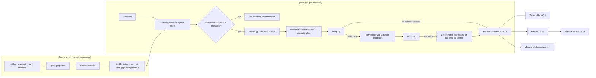
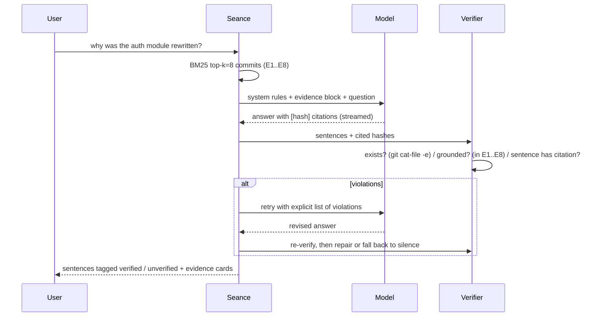

# The Ghost Maintainer: Implementation Plan

> A séance for a dead repo. You ask a question, a local open-weight model answers as the repo's departed maintainers, and every claim must cite a real commit. If the history holds no evidence, the ghost says **"The dead do not remember."**

**Target:** Hacktoberfest 2026 · DEV Week 4 challenge, **"Ghost in the Machine"**. It closes **Sat Oct 31, 11:59 PM PDT (Sun Nov 1, 12:29 PM IST)**, about 3.5 days from now. Judging weighs **writing quality** most heavily, then theme fit (open-weight models at the core), creativity, technical execution, and an optional partner track.

**Environment found:** an empty workspace, Windows, Python 3.14 (Unsloth needs ≤3.12, so `uv` will pin 3.12), `uv 0.13`, Node 26, git 2.56, GTX 1650 with **4 GB** VRAM, no CUDA toolkit (not needed; torch wheels bundle it), no Ollama, and **no DevRelay MCP gateway connected**.

---

## User Review Required

> [!IMPORTANT]
> **The open-weight model stays at the core.** Unsloth + Qwen3-4B-Instruct-2507 (4-bit) is the default and is the model in every number the post headlines. The OpenAI backend you asked for (`gpt-6-luna`) is an opt-in **reference baseline** in the eval ("how honest is a frontier model under the same rules?"). The challenge requires open models to drive the core, so the post will frame it that way.

> [!IMPORTANT]
> **The séance is read-only on the target repo.** We never write into the dead repo. The BM25 index is cached under `.ghost/<repo-hash>/` in Ghost Maintainer's own cache dir (`GHOST_CACHE_DIR`, gitignored). Tell me if you actually wanted the cache inside the target repo.

> [!WARNING]
> **Unsloth on native Windows is the biggest technical risk** (triton/bitsandbytes wheels). Mitigation: Unsloth is an optional extra (`pip install ghost-maintainer[unsloth]`). If it fails, the fallback is the `openai_compat` backend pointed at a local llama.cpp/Ollama server running a Qwen3-4B GGUF. That still counts as an open-weight model, so the submission isn't blocked.

> [!WARNING]
> **Real people.** request's maintainers are real and living. The ghost speaks as a collective "we", names authors in the third person exactly as git records them, never invents quotes, and always shows **"Voices are fiction. Evidence is real."**

> [!NOTE]
> **Submission is manual.** DevRelay isn't connected, so I'll write `submission/dev-post-draft.md` and `submission/checklist.md`, and you publish on DEV and link MyMLH. If you connect DevRelay later, I can pull the exact Week 4 `full_details` (required tag/template) and run the MLH chain.

## Open Questions

1. **GitHub username**, for README badges, clone URLs, and the post. Placeholders (`<you>`) until you tell me.
2. **The OpenAI model id `gpt-6-luna`.** I'll make it the default for `GHOST_OPENAI_MODEL` as you asked, but I can't verify the id exists. It's just config.
3. **Eval gold answers.** I'll mine request/request's history to write 25 questions with gold commit hashes and validate them with a script. Please skim `evals/request.yaml` before the final run, since the post rests on it.

---

## Architecture



### Honesty pipeline in detail



---

## Proposed Changes

The repo root is `c:\Users\sahoo\ML_Projects\Ghost_Maintainer`, with a `src/` layout managed by `uv` + `hatchling`.

### 1. Packaging & tooling

#### [NEW] pyproject.toml
- `requires-python = ">=3.10,<3.13"` (Unsloth constraint), `[project.scripts] ghost = "ghost_maintainer.cli:app"`
- Core deps: `typer`, `rich`, `bm25s`, `PyStemmer`, `pydantic>=2`, `pydantic-settings`, `fastapi`, `uvicorn`, `sse-starlette`, `pyyaml`, `platformdirs`, `httpx`
- Extras: `unsloth` (torch cu12x + `unsloth`), `openai` (`openai`), `dev` (`pytest`, `pytest-cov`, `ruff`, `mypy`, `pre-commit`)
- Ruff (lint + format) and strict-ish mypy config.

#### [NEW] `.python-version` (3.12), `.gitignore`, `.pre-commit-config.yaml`, `.env.example`

---

### 2. Git archaeology (`src/ghost_maintainer/gitlog.py`)

A single streaming `git log` call with unambiguous record separators, so huge repos parse in one pass:

```python
FMT = "%x1e%H%x1f%an%x1f%ae%x1f%aI%x1f%s%x1f%b%x1f"


# git -C <repo> log --all --no-color --numstat --format=<FMT>
@dataclass(frozen=True, slots=True)
class Commit:
    sha: str
    short: str
    author: str
    email: str
    date: datetime
    subject: str
    body: str
    files: tuple[FileChange, ...]  # path, added, deleted
    hunks: tuple[str, ...] = ()  # e.g. "@@ def authenticate(" (function context only)
```

- Hunk headers come from a second pass, `git log -p -U0 --format=%x1e%H`, keeping only `@@ … @@ <context>` lines, capped at 20 per commit. This captures *which functions* changed without diffs flooding BM25.
- Merge commits are kept (their messages often hold the "why"), with numstat taken from the first parent.
- Errors: "not a git repo", shallow clone (warn: *"History is shallow; the dead remember less."*), empty repo.

### 3. Index & retrieval (`index.py`, `retrieve.py`)

- The document text per commit is `subject ×2 + body + author + path tokens ×2 + hunk contexts`. Repeating fields is the cheap BM25F-style boost: path tokens split on `/ _ . -` and camelCase, so "auth module" matches `lib/auth.js` and `OAuthSigner`.
- `bm25s` with English stemming + stopwords. Saved with `commits.jsonl` + `meta.json` (repo path, HEAD sha, commit count, version) under `.ghost/<sha256(abs_path)[:12]>/`. The index rebuilds automatically when HEAD changes.
- `retrieve(q, k=8)` returns `Evidence(tag="E1", commit, score)`. The **retrieval gate**: if the top score falls below a calibrated threshold (`GHOST_MIN_SCORE`, tuned on the eval set and documented), we short-circuit to silence **without calling the model**. That's cheap and honest.

### 4. Prompt (`prompt.py`): cite or stay silent

```text
You are the spirit of the {repo} repository, speaking for its departed maintainers as "we".
RULES — breaking any rule is a failure:
1. Use ONLY the EVIDENCE below. You know nothing else about this project.
2. Every sentence that states a fact MUST end with one or more citations like [3f2a9c1].
   Only cite hashes that appear in EVIDENCE.
3. Name people only as written in EVIDENCE, in third person. Never invent quotes.
4. If the EVIDENCE does not answer the question, reply with exactly:
   The dead do not remember.
5. At most 5 sentences. Eerie but plain; no theatrics that add facts.

EVIDENCE
[3f2a9c1] 2019-02-11 · mikeal · "Deprecate request" · files: README.md
  body: ...
...
QUESTION: {q}
```

Few-shot: one grounded answer and one refusal example (using a fake repo, so no leakage into the real one). The Qwen3 "thinking" output is disabled or stripped.

### 5. Backends (`backends/`)

```python
class Backend(Protocol):
    name: str

    def generate(
        self, messages: list[Msg], *, max_new_tokens: int, temperature: float
    ) -> Iterator[str]: ...
```

| Backend | Use | Notes |
|---|---|---|
| `unsloth` (default) | `unsloth/Qwen3-4B-Instruct-2507-bnb-4bit`, `FastLanguageModel.for_inference`, `TextIteratorStreamer` | `max_seq_length=4096`, greedy (temp 0) for eval reproducibility; lazy-loaded once per process |
| `openai_compat` | OpenAI (`gpt-6-luna` via `OPENAI_API_KEY`) **or** any local OpenAI-compatible server (Ollama, llama.cpp, LM Studio) via `GHOST_BASE_URL` | One code path covers both the GPU-less fallback and the frontier baseline |
| `mock` | CI and tests | Deterministic scripted outputs, including deliberately hallucinated hashes to exercise the verifier |

### 6. Verifier (`verify.py`): the measurable core

```python
CITE = re.compile(r"\[([0-9a-f]{7,40})\]")


@dataclass
class SentenceVerdict:
    text: str
    cited: list[str]
    exists: list[bool]  # git cat-file -e <h>^{commit}, resolved via the commit store (prefix match)
    grounded: list[bool]  # resolved sha ∈ retrieved evidence set
    status: Literal["verified", "unverified", "uncited"]
```

- Sentence split (regex, aware of abbreviations, versions, and code spans). A sentence is **verified** only if it has ≥1 citation and all its citations exist and are grounded.
- Bare hex strings that aren't in brackets also get checked, so the model can't sneak in an uncited fake hash.
- A cheap **support hint**: lexical overlap between the sentence and its cited commit text, shown as "weak link" in the UI. It's a hint only, kept out of the headline metrics (it's heuristic).

### 7. Orchestrator (`seance.py`)

`Seance.ask(q, mode="guarded"|"raw")` yields typed events: `Evidence`, `Token`, `Reconsidering`, `Verdict`, `Done`.
- **raw** = prompt only. The output is verified and labeled, never altered. This feeds the "before" numbers.
- **guarded** = retrieval gate → generate → verify → one retry with a violation list → repair (keep verified sentences; if none remain, answer "The dead do not remember."). This feeds the "after" numbers.

### 8. CLI (`cli.py`, Typer + Rich)

| Command | Purpose |
|---|---|
| `ghost summon <path-or-git-url>` | Clone (if URL) + parse + index, with a progress bar: *"Gathering 2,213 memories…"* |
| `ghost ask "<question>" [--raw] [--k 8] [--backend …] [--json]` | One answer. Sentences colored by verdict, evidence table below |
| `ghost seance` | Interactive REPL |
| `ghost serve [--port 6660]` | Web UI |
| `ghost eval evals/request.yaml [--modes raw,guarded] [--backend …]` | Honesty report |
| `ghost doctor` | Checks the Python version, CUDA/VRAM, backend availability, and git |

### 9. API (`server.py`, FastAPI)

- `POST /api/summon {source}` → indexing progress (SSE)
- `GET /api/repos` · `GET /api/ask?q=…&mode=…` (SSE events: `evidence`, `token`, `reconsidering`, `verdict`, `done`, `error`)
- `GET /api/commit/{sha}` → full message + files, used by the evidence card "open" action
- Serves `web/dist` at `/`. Binds to localhost only.

---

### 10. Web UI (`web/`, Vite + React + TS), designed with apple-grade-design

**Design intent.** The Ghost Maintainer feels *quiet, candlelit, and exact* for an engineer inheriting or studying an abandoned codebase late at night. Its one job is to answer "why?" about a codebase's past without ever making something up. Content leads: the ghost's sentences and the evidence cards that prove them. **It refuses to be a Halloween novelty: no cartoon ghosts, no dripping fonts, no fog effects that sit on top of the text.** We'll know it works when a viewer can tell, without reading a legend, which sentences are proven and which aren't.

Design-award lenses we're targeting: **Innovation** (verifiable AI), **Visuals** (cohesive candle and archive language), **Interaction** (evidence one hover/tap away).

**Layout.** It's a single screen. A narrow top bar holds the repo name and commit count. The center column holds the conversation, set in a serif for the ghost's voice. The right rail holds evidence cards. On narrow screens the rail collapses into inline cards under each answer. Hovering or focusing a citation chip highlights its card, and vice versa.

**Tokens** (`web/src/styles/tokens.css`, semantic only):

```css
:root {
  --color-bg: oklch(14% 0.01 60);          /* near-black ink */
  --color-surface: oklch(18% 0.012 60);
  --color-text: oklch(92% 0.01 80);
  --color-text-muted: oklch(70% 0.01 80);
  --color-accent: oklch(78% 0.14 70);      /* candle amber; the only accent */
  --color-verified: var(--color-accent);
  --color-unverified: oklch(70% 0.02 260); /* cold, desaturated; paired with dashed underline + icon, never color alone */
  --font-voice: "Fraunces", Georgia, serif;
  --font-evidence: "JetBrains Mono", ui-monospace, monospace;
  --font-ui: "Inter", system-ui, sans-serif;
  --radius-card: 14px; --radius-chip: 8px;  /* concentric: chip = card − padding */
  --motion-flicker: 2.4s; --ease-standard: cubic-bezier(.2,.0,.0,1);
}
@media (prefers-reduced-motion: reduce) { :root { --motion-flicker: 0s; } }
```

Fonts are self-hosted (OFL), so it works offline.

**Every state is designed:**

| State | What the user sees |
|---|---|
| First run / no repo | *"Name a repository to summon."* plus a path/URL field and a "Summon request/request" example |
| Indexing | Progress with real counts: *"Gathering memories… 1,204 of 2,213 commits"* |
| Ready / empty conversation | 3 suggested questions mined from the repo's most-touched paths |
| Retrieving | Evidence cards fade in before the first token, so the proof arrives before the claim |
| Streaming | Text streams; citation chips are pending (outlined) until the verdict arrives |
| Reconsidering (retry) | *"The spirits reconsider…"*: honest, visible, never hidden |
| Verified / unverified | Amber chip + seal ✓ / cold chip + dashed underline + "unverified" label (redundant cues for color-blind users) |
| Silence (refusal) | A centered, dimmed line, *"The dead do not remember."*, with a quiet sub-line: *"No commit speaks to this. Try naming a file or feature."* |
| Error | Calm and practical: *"The model didn't load. Check that your GPU has 3 GB free, or run `ghost doctor`."* |
| Large text / 200% zoom | Fluid type scale; the rail reflows under answers |

**Copy voice:** *Eerie but plain · Exact · Never blames the user.* The full copy deck goes in `docs/design.md`.

**Accessibility:** WCAG AA contrast checked on the tokens, full keyboard path (citation chips are buttons that move focus to their card), `aria-live="polite"` for streamed answers, and verdict announcements ("2 of 3 sentences verified").

---

### 11. Honesty benchmark (`eval/`, `evals/request.yaml`)

```yaml
repo: https://github.com/request/request
questions:
  - id: q01
    q: "Why was request deprecated?"
    answerable: true
    gold: ["<sha>"]          # validated to exist by scripts/validate_eval.py
  - id: q18
    q: "Why did the maintainers switch from Mocha to Jest?"   # never happened
    answerable: false
```

Planned split: 25 questions, 15 answerable and 10 unanswerable. The unanswerable ones are plausible but false premises, which are the hardest trap for a 4B model.

**Metrics** (per mode × backend), each with **Wilson 95% intervals** because n is small and the post should say so:

| Metric | Definition |
|---|---|
| **Citation existence rate** | cited hashes that resolve to a real commit ÷ all cited hashes |
| **Citation grounding rate** | cited hashes that were in the retrieved evidence ÷ all cited hashes |
| **Sentence verification rate** | factual sentences with ≥1 valid, grounded citation ÷ all factual sentences |
| **Refusal recall** | unanswerable questions answered "The dead do not remember." ÷ unanswerable questions |
| **Refusal precision** | correct refusals ÷ all refusals (did it go silent on answerable questions?) |
| **Answer support** | answerable questions citing ≥1 gold hash ÷ answerable questions |

Output: `reports/eval-<date>.json` + `reports/eval-<date>.md`. The Markdown report is a table ready to paste into the post. `scripts/verify_citations.py` independently re-checks every hash in a report against a fresh clone with `git cat-file`, so anyone can reproduce the headline number.

---

### 12. Tests (`tests/`)

- `conftest.py` builds a **synthetic git repo** in tmp (an auth rewrite, a dropped Windows CI, a deprecation commit), so tests are hermetic and offline.
- `test_gitlog.py` (separators, merges, unicode, empty body), `test_index.py` (path boosting, rebuild on HEAD change), `test_verify.py` (fake hash, real-but-ungrounded hash, bare hex, uncited sentence, prefix collision), `test_seance.py` (mock backend: retry path, repair path, gate path), `test_server.py` (SSE event order), `test_eval.py` (metric math, Wilson CI).
- Target ≥85% coverage on the core (CI ignores the backend GPU code).

### 13. Open-source kit

- [NEW] `README.md`: hero screenshot, one-line pitch, a 60-second quickstart, how honesty works, the eval table, a Windows/GPU notes section, and an ethics note
- [NEW] `LICENSE` (MIT), `CONTRIBUTING.md`, `CODE_OF_CONDUCT.md` (Contributor Covenant 2.1), `SECURITY.md`, `CHANGELOG.md` (Keep a Changelog, `0.1.0`)
- [NEW] `.github/ISSUE_TEMPLATE/{bug,feature,haunting_report}.yml`, `PULL_REQUEST_TEMPLATE.md`, `workflows/ci.yml` (matrix py3.10–3.12 on ubuntu/windows: ruff, mypy, pytest with mock; node: `npm ci && npm run build && npm run lint`)
- [NEW] `docs/architecture.md`, `docs/honesty.md` (threat model of hallucination + metric definitions), `docs/design.md` (intent, tokens, copy deck, states, a11y results)
- Topics/labels: `hacktoberfest`, `good first issue` seeds (e.g. "add CHANGELOG ingestion", "add a Gemma backend")

### 14. Submission (`submission/`)

- [NEW] `dev-post-draft.md`, structured for the rubric: the hook ("I held a séance for request/request"), what it is, theme interpretation, **why open weights matter here** (local, private, auditable, runs on a 4 GB laptop GPU), the honesty experiment with raw vs guarded numbers and intervals, failure stories (real hallucinated hashes the verifier caught), architecture diagram, demo GIF, repo link, AI-use disclosure.
- [NEW] `checklist.md`: license, public repo, demo video, required tag/template, MyMLH link, and a deadline in both timezones.

---

## Timeline to the deadline

| When (IST) | Milestone |
|---|---|
| Oct 28 night – Oct 29 | Scaffold, gitlog, index, prompt, verifier, seance + mock, CLI, tests green, CI |
| Oct 29 – Oct 30 | Unsloth backend on the GTX 1650 (fallback ready), openai_compat, summon request/request, eval set + first eval run |
| Oct 30 – Oct 31 | Web UI (all states), SSE, design critique + a11y pass, screenshots |
| Oct 31 | Final eval run, README/docs, post draft, demo recording, checklist |
| Nov 1 before 12:29 PM IST | **You publish** on DEV (buffer: ~half a day) |

---

## Verification Plan

### Automated Tests
```powershell
uv venv --python 3.12; uv pip install -e ".[dev]"
uv run ruff check . ; uv run ruff format --check . ; uv run mypy src
uv run pytest -q --cov=ghost_maintainer
cd web; npm ci; npm run lint; npm run build
```

### End-to-end
```powershell
uv pip install -e ".[unsloth,openai]"
uv run ghost doctor
uv run ghost summon https://github.com/request/request
uv run ghost ask "Why was request deprecated?"
uv run ghost ask "Why did they switch to Jest?"          # expect: The dead do not remember.
uv run ghost eval evals/request.yaml --modes raw,guarded
uv run python scripts/verify_citations.py reports/eval-*.json --repo <clone>
uv run ghost serve   # browser check of every UI state, keyboard-only pass, reduced-motion, 200% zoom
```

### Manual Verification (you)
- Skim `evals/request.yaml` gold answers.
- Watch the demo flow in the browser; confirm the tone feels "quiet archive," not novelty.
- Publish the DEV post and link MyMLH before the deadline.
